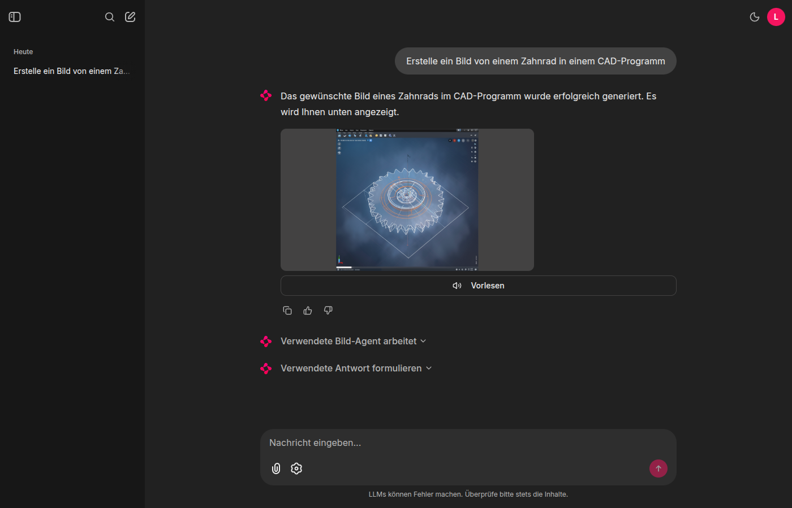
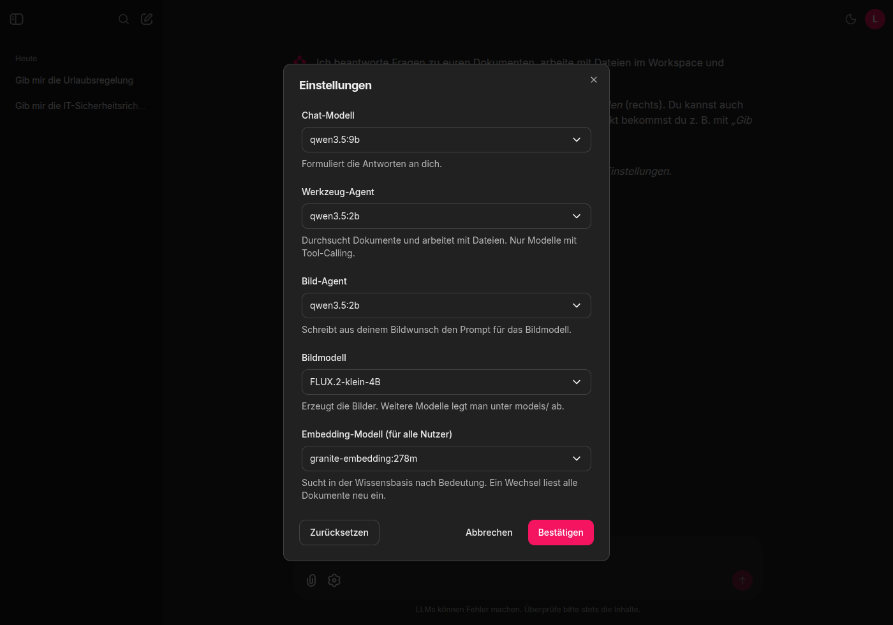

# RAG-Chatbot

Prototyp eines firmeninternen Chatbots, der lokal laufende Sprachmodelle über **Ollama** nutzbar macht. Alles läuft auf dem eigenen Rechner, keine Daten verlassen das Haus.



- **Wissensbasis aus eigenen Dokumenten** (PDF, DOCX, TXT, MD, CSV, JSON, …), indexiert in Qdrant mit Ollama-Embeddings
- **Hybride Suche:** Embeddings (Bedeutung) und BM25 (exakte Begriffe wie Abkürzungen, Normen, Artikelnummern)
- **Dokumentsuche ohne Modell:** „Gib mir die Reisekostenrichtlinie“ liefert direkt das Dokument als Link
- **Werkzeug-Agent** auf Basis von LangChain (`create_agent`): durchsucht Dokumente und arbeitet mit Dateien, begrenzt auf den Ordner `workspace/` (Lesen, Schreiben ohne stilles Überschreiben, Auflisten, Suchen; kein Löschen)
- **Bild-Agent** mit FLUX.2 [klein] 4B: „Erstelle ein Bild von …“ erzeugt lokal ein Bild und zeigt es im Chat
- **Einstellungen pro Nutzer:** Sprach- und Bildmodelle für Chat und Agenten im Benutzermenü wählen
- **Oberfläche** mit [Chainlit](https://github.com/Chainlit/chainlit), eingebunden in einen FastAPI-Server, mit Chat-Historie und Vorlesefunktion
- **Installer** für Linux, WSL, macOS und Windows

## Voraussetzungen

- **Python 3.10 oder neuer.** Unter Debian/Ubuntu (auch WSL) zusätzlich `sudo apt install python3-venv`.
- **[Ollama](https://ollama.com)** mit mindestens einem Sprachmodell, das Tool-Calling kann, und einem Embedding-Modell.
- **Für Bilder:** etwa 23 GB freier Arbeitsspeicher beim Laden des Modells (32 GB RAM im Rechner empfohlen), eine NVIDIA-GPU mit 8 GB Grafikspeicher oder mehr (empfohlen) und etwa 20 GB freier Speicherplatz (16 GB Modell, dazu PyTorch). Ohne GPU läuft FLUX auf der CPU, aber sehr langsam.

## Installation

**Linux, WSL, macOS**

```bash
./install.sh --dev
```

**Windows:** `install.bat --dev` in der Eingabeaufforderung oder per Doppelklick.

Beide Starter rufen `install.py` auf. Das geht auch direkt: `python install.py --dev`.

| Option | Wirkung |
|---|---|
| `--dev` | zusätzlich die Test-Pakete (pytest, httpx) |
| `--no-image` | ohne Bildgenerierung: kein PyTorch, kein FLUX-Download |
| `--force` | `.venv` neu anlegen und alles neu installieren |

Der Installer erledigt nacheinander:

1. **Virtuelle Umgebung** `.venv` anlegen. Fehlt sie oder ist sie defekt, wird sie neu angelegt.
2. **PyTorch** in der passenden Variante installieren (siehe [Bildgenerierung](#bildgenerierung)).
3. **Abhängigkeiten** aus `pyproject.toml` installieren.
4. **FLUX.2 [klein] 4B** einmalig nach `models/FLUX.2-klein-4B/` laden (etwa 16 GB). Ein abgebrochener Download wird beim nächsten Aufruf fortgesetzt.

Bereits erledigte Schritte werden übersprungen. Neu installiert wird nur, wenn sich `pyproject.toml` oder die Optionen geändert haben. Den Installer kann man also gefahrlos mehrfach aufrufen.

Danach die Ollama-Modelle laden (die Standardwerte, andere lassen sich später in den Einstellungen wählen):

```bash
ollama pull qwen3:1.7b            # Agent-Modell (muss Tool-Calling können)
ollama pull cas/teuken-7b-q4km    # Chat-Modell (Teuken, formuliert die Antworten)
ollama pull nomic-embed-text      # Embedding-Modell
```

Die App selbst lädt **keine** Modelle herunter. Fehlt ein Ollama-Modell, kommt eine Fehlermeldung mit dem passenden `ollama pull`-Befehl.

**Hinweise zu WSL:** Windows und WSL können sich keine `.venv` teilen. Findet der Installer eine unter dem anderen System angelegte `.venv`, bricht er mit einem Hinweis ab, statt sie zu löschen. Das Projekt am besten im Linux-Dateisystem (`~/...`) klonen, nicht unter `/mnt/c`, dort ist alles deutlich langsamer.

Manuell geht es auch ohne Installer: `pip install ".[dev,image]"` in einer eigenen Umgebung. Dann muss man PyTorch und das FLUX-Modell aber selbst passend einrichten.

## Start

```bash
python main.py
```

Die Oberfläche läuft auf http://localhost:8000 (leitet nach `/ui`), die API-Dokumentation unter http://localhost:8000/docs.

`main.py` nutzt automatisch das Python aus `.venv`, auch wenn es mit einem anderen Python gestartet wird (z. B. über den Run-Button der IDE). Ein vorheriges `source .venv/bin/activate` (Windows: `.venv\Scripts\activate`) ist nur für andere Befehle wie `pytest` nötig.

Weitere Modi: `python main.py --mode chat --message "Hallo"` (eine Frage im Terminal), `--mode frontend` bzw. `--mode all` (separates Node-Frontend unter `app/ai-chatbot`, falls vorhanden). Host und Port mit `--host` und `--port`.

## So arbeitet der Chatbot

```
Nachricht
 ├─ Bildwunsch? ("Erstelle ein Bild von …")
 │    └─ Bild-Agent: schreibt englischen Prompt ─▶ FLUX erzeugt Bild ─▶ Bild im Chat
 ├─ Dokumentanfrage? ("Gib mir die Reisekostenrichtlinie")
 │    └─ Dokumentsuche: Dateinamen abgleichen ─▶ Link zum Dokument (ohne Sprachmodell)
 └─ sonst
      └─ hybride Suche (Embeddings + BM25) ─▶ Werkzeug-Agent (Dokumente, Dateien) ─▶ Chat-Modell formuliert Antwort
```

- **Werkzeug-Agent** (`AGENT_MODEL`): bekommt die passenden Dokumentauszüge mit und ruft bei Bedarf Tools auf. Braucht ein Modell mit gutem Tool-Calling.
- **Chat-Modell** (`CHAT_MODEL`): schreibt aus Frage, Dokumenttreffern und Tool-Ergebnissen die endgültige Antwort. Ist es dasselbe Modell wie der Agent, entfällt dieser Schritt.
- **Bild-Agent** (`IMAGE_PROMPT_MODEL`): macht aus dem Bildwunsch einen detaillierten englischen Prompt. Bezüge auf den bisherigen Chat („mach noch eins davon“) löst er über den Gesprächsverlauf auf. Ist kein Modell erreichbar, geht der Wunsch unverändert an FLUX.

### Hybride Suche

Die Wissensbasis sucht auf zwei Wegen und führt die Ergebnisse zusammen:

- **Embeddings** finden Textabschnitte mit ähnlicher *Bedeutung*, auch bei anderer Wortwahl („Geld pro Kilometer“ → „Kilometerpauschale“).
- **BM25** (Okapi BM25, `src/rag_chatpipline/bm25.py`) findet *exakte Begriffe*. Seltene Begriffe zählen mehr, Füllwörter wie „der“ oder „wie“ gar nicht. Hier sind Embeddings schwach: Abkürzungen, Firmennamen, Normen wie „ISO 10012“, Kennungen wie „DP-17“ oder Bestellnummern.
- **Zusammenführung** per *Reciprocal Rank Fusion*: Jede Suche liefert ihre 20 besten Abschnitte, gezählt wird der Platz in beiden Listen. Ein Abschnitt, der in beiden weit oben steht, gewinnt. Gewichte muss man dafür nicht einstellen.

In einem Vergleich mit ähnlichen Dokumenten, die sich nur in Kennungen unterscheiden, traf die hybride Suche bei 9 von 10 Fragen das richtige Dokument auf Platz 1, die reine Embedding-Suche bei 8 von 10. Mit `RETRIEVAL_MODE=dense` lässt sich zum Vergleich auf die reine Embedding-Suche umschalten. Grenze: BM25 kennt keine Wortformen, „Vorfall“ und „Vorfälle“ sind für BM25 verschiedene Wörter.

### Dokumentsuche

Wer ein bestimmtes Dokument *haben* will („Gib mir …“, „Zeig mir …“, „Wo finde ich …“, „Ich brauche …“, „Schick mir …“), bekommt es direkt als Link, ohne Sprachmodell und damit in Sekundenbruchteilen. Der Dateiname wird mit der Anfrage abgeglichen:

- Groß- und Kleinschreibung, Umlaute, Bindestriche und Unterstriche spielen keine Rolle, kleine Tippfehler auch nicht.
- Zusammengesetzte Wörter müssen den Dateinamen weitgehend abdecken: „Reisekosten-Richtlinie“ findet `Reisekostenrichtlinie.pdf`, aber „Richtlinie“ allein nicht `IT-Sicherheitsrichtlinie.pdf`.
- Zahlen im Dateinamen (z. B. Jahreszahlen) entscheiden nur bei Gleichstand. Passen mehrere Dokumente gleich gut, bietet der Chatbot alle an.

Fragen zum *Inhalt* („Was steht in der Reisekostenrichtlinie zu Hotels?“, „Wie hoch ist … laut …“) und Anfragen ohne passendes Dokument gehen wie bisher an Suche und Werkzeug-Agent.

### Bildwünsche

Erkannt wird ein Bildwunsch an einem Verb (erstelle, generiere, erzeuge, zeichne, male, mach, …) zusammen mit einem Bildwort (Bild, Foto, Grafik, Illustration, Zeichnung, Logo, …), auch auf Englisch. „Wie groß ist der Bildschirm?“ zählt also nicht dazu. Fällt ein Wunsch durch dieses Raster, kann der Werkzeug-Agent den Bild-Agenten über das Tool `generate_image` trotzdem aufrufen.

## Bedienung

- **Antworten** erscheinen Wort für Wort. Darüber zeigt die Oberfläche die Arbeitsschritte (Wissensbasis, Tool-Aufrufe, Bild-Agent, Antwort formulieren). Bei Bildern steht dort auch der Prompt, den der Bild-Agent geschrieben hat.
- **Einstellungen** (Benutzermenü oben rechts oder Zahnrad neben dem Eingabefeld): Chat-Modell, Werkzeug-Agent, Bild-Agent und Bildmodell wählen. Mehr dazu unter [Einstellungen](#einstellungen).
- **Wissensquellen** (rechte Seitenleiste): Dokumente hochladen, per Klick auf den Namen öffnen und entfernen. Alternativ eine Datei an eine Nachricht anhängen.
- **Dokumente direkt:** „Gib mir die Reisekostenrichtlinie“ antwortet sofort mit einem Link zum Dokument.
- **Alte Chats** (linke Seitenleiste): Chats werden in `memory/chainlit.db` gespeichert und lassen sich wieder öffnen. Der Gesprächsverlauf wird dabei für das Modell wiederhergestellt, auch nach einem Neustart.
- **Vorlesen:** Button an jeder neuen Antwort (nicht in wieder geöffneten alten Chats).
- **Nutzer:** Es gibt keinen Login. Alle teilen sich den Nutzer `lokal`. Steht ein Reverse-Proxy mit SSO davor, der den Header `X-Forwarded-User` setzt, hat jeder seine eigenen Chats und Einstellungen. Ohne vertrauenswürdigen Proxy lässt sich dieser Header fälschen.

## Einstellungen



| Einstellung | Wofür | Zur Auswahl |
|---|---|---|
| Chat-Modell | formuliert die Antworten | lokale Ollama-Sprachmodelle |
| Werkzeug-Agent | Dokumentsuche, Dateien | lokale Ollama-Modelle mit Tool-Calling |
| Bild-Agent | schreibt die FLUX-Prompts | lokale Ollama-Sprachmodelle |
| Bildmodell | erzeugt die Bilder | vollständig heruntergeladene Modelle unter `models/` |
| Embedding-Modell (für alle Nutzer) | Bedeutungssuche in der Wissensbasis | lokale Ollama-Embedding-Modelle |

- **Nur lokale Modelle:** Cloud-Modelle von Ollama (z. B. `gpt-oss:120b-cloud`) erscheinen absichtlich nicht, weil sie Daten an fremde Server schicken würden. Embedding-Modelle erscheinen nur im Feld *Embedding-Modell*.
- **Speicherung:** Die Wahl gilt sofort und wird pro Nutzer in `memory/user_settings.json` gespeichert. Ist ein gespeichertes Modell nicht mehr installiert, nimmt die App den Standard aus der Konfiguration und, falls auch der fehlt, das erste verfügbare Modell.
- **Gesprächsverlauf:** Ein Wechsel des Agent-Modells mitten im Chat behält den Verlauf.
- **Embedding-Modell:** Es gehört zur gemeinsamen Wissensbasis und gilt deshalb für **alle** Nutzer (gespeichert in `memory/app_settings.json`). Jedes Embedding-Modell hat in Qdrant eine eigene Sammlung. Beim Wechsel liest die App die Dokumente aus dem Dokumentenordner mit dem neuen Modell ein, eine Meldung im Chat zeigt Beginn und Ende. Wechselt man zu einem früher genutzten Modell zurück, werden nur die inzwischen hinzugekommenen Dokumente eingelesen. Ist das eingestellte Modell nicht installiert und wurde noch keins gewählt, nimmt die App das erste installierte Embedding-Modell.
- **Menüpunkt:** Chainlit bietet im Benutzermenü keine eigenen Einträge an. Den Punkt *Einstellungen* fügt `src/ui/public/user_menu_settings.js` ein. Fehlt er nach einem Chainlit-Update, öffnet das Zahnrad neben dem Eingabefeld denselben Dialog.

Die REST-API (`POST /chat`) nutzt immer die Standardmodelle aus der Konfiguration.

## Bildgenerierung

Standardmodell ist **[FLUX.2 [klein] 4B](https://huggingface.co/black-forest-labs/FLUX.2-klein-4B)** von Black Forest Labs (Apache-2.0). Es erzeugt ein Bild in 4 Schritten.

- **PyTorch-Variante:** Der Installer prüft die GPU mit `nvidia-smi` und wählt:

  | System | PyTorch |
  |---|---|
  | NVIDIA-GPU ab Turing (RTX 20xx und neuer), Treiber 580 oder neuer | `cu130` |
  | ältere NVIDIA-GPU (z. B. GTX 10xx) oder älterer Treiber | `cu126` (neuere PyTorch-Builds unterstützen diese GPUs nicht mehr) |
  | keine NVIDIA-GPU | CPU-Paket (spart mehrere GB) |
  | macOS | Standardpaket von PyPI |

- **Grafikspeicher:** FLUX läuft auf GPUs ohne bfloat16 (z. B. GTX 10xx) in float16, sonst in bfloat16. Es holt immer nur den gerade nötigen Modellteil in den Grafikspeicher, damit auch Karten mit 8 bis 12 GB reichen. Auf einer GTX 1080 Ti (11 GB) braucht ein Bild mit 768 × 768 Pixeln höchstens 8,4 GB Grafikspeicher und gut eine Minute.
- **Arbeitsspeicher:** Dafür liegt das ganze Modell im Arbeitsspeicher: beim Laden kurz bis zu 23 GB, danach rund 18 GB. Vor dem Laden prüft die App, ob genug frei ist, und meldet sonst im Chat, statt den Rechner in Speichermangel zu treiben. 60 Sekunden nach dem letzten Bild gibt sie das Modell wieder frei (`IMAGE_KEEP_ALIVE`). Das nächste Bild lädt es neu, das kostet etwa 10 Sekunden.
- **Nur eine Instanz:** Zwei gleichzeitig laufende Chatbot-Server mit geladenem FLUX passen nicht in 32 bis 40 GB RAM.
- **Ollama und FLUX:** Vor jedem Bild entlädt die App die Ollama-Modelle aus dem Grafikspeicher. Ollama lädt sie bei der nächsten Frage von selbst wieder, die erste Antwort nach einem Bild dauert deshalb etwas länger. Es wird immer nur ein Bild gleichzeitig erzeugt.
- **Weitere Bildmodelle:** Jedes diffusers-Modell lässt sich als Ordner unter `models/` ablegen. Mit einer leeren Datei `.download-complete` darin erscheint es in den Einstellungen.
- **Ohne passende Hardware:** `IMAGE_BACKEND=mock` setzen (graues Platzhalterbild) oder mit `--no-image` installieren.

Erzeugte Bilder liegen in `workspace/AIbilder/` und sind über `/images/{name}` abrufbar.

## Konfiguration (Umgebungsvariablen)

| Variable | Standard | Bedeutung |
|---|---|---|
| `CHAT_MODEL` | `cas/teuken-7b-q4km:latest` | Chat-Modell: formuliert die Antworten (Teuken) |
| `AGENT_MODEL` | `qwen3:1.7b` | Werkzeug-Agent: ruft Tools auf, braucht gutes Tool-Calling |
| `IMAGE_PROMPT_MODEL` | wie `AGENT_MODEL` | Bild-Agent: schreibt aus dem Bildwunsch den englischen FLUX-Prompt |
| `EMBEDDING_MODEL` | `nomic-embed-text` | Ollama-Embeddingmodell (Standard, solange in den Einstellungen keins gewählt ist) |
| `RETRIEVAL_MODE` | `hybrid` | `hybrid` (Embeddings + BM25) oder `dense` (nur Embeddings, zum Vergleich) |
| `AGENT_REASONING` | leer | `true`/`false` schaltet das Denken des Agent-Modells ein/aus |
| `OLLAMA_BASE_URL` | `http://localhost:11434` | Ollama-Adresse |
| `WORKSPACE_DIR` | `./workspace` | Einziger Ordner, auf den der Agent zugreifen darf |
| `IMAGE_BACKEND` | `flux` | `flux` oder `mock` (graues Platzhalterbild zum Testen) |
| `FLUX_MODEL` | `black-forest-labs/FLUX.2-klein-4B` | Bildmodell, das der Installer von Hugging Face lädt |
| `MODELS_DIR` | `./models` | Ablage der Bildmodelle |
| `IMAGE_SIZE` | `768` | Kantenlänge der Bilder in Pixeln |
| `IMAGE_KEEP_ALIVE` | `60` | Sekunden, die das Bildmodell nach dem letzten Bild im Arbeitsspeicher bleibt (`0` = sofort freigeben) |
| `CORS_ORIGINS` | `http://localhost:3000` | Erlaubte Frontend-Origins, kommagetrennt |

Die Modelle sind Standardwerte. Jeder Nutzer kann Chat-, Agent- und Bildmodelle in den Einstellungen für sich ändern. Das Embedding-Modell lässt sich dort für alle ändern, die Wissensbasis wird dann automatisch neu eingelesen.

## API

| Route | Zweck |
|---|---|
| `POST /chat` `{message, chatId?}` | Agent-Antwort `{text, chatId, images[]}` (`/rag` ist ein Alias) |
| `GET /documents`, `POST /documents`, `DELETE /documents/{name}` | Wissensbasis verwalten |
| `GET /images/{name}` | erzeugte Bilder |
| `GET /files/{name}` | Dokument der Wissensbasis zum Ansehen im Browser |
| `GET /health` | Statusprüfung |

Die API hält den Verlauf pro `chatId` nur im Arbeitsspeicher. Die Oberfläche stellt ihn aus der gespeicherten Historie wieder her.

## Tests

```bash
./install.sh --dev
source .venv/bin/activate     # Windows: .venv\Scripts\activate
pytest
```

Die Tests brauchen weder Ollama noch eine GPU noch das FLUX-Modell: Modelle werden durch vorgegebene Antworten ersetzt, Bilder durch ein Platzhalterbild.

## Daten und Ordner

Alles, was zur Laufzeit entsteht, steht in `.gitignore` und landet nicht im Repository:

| Ordner | Inhalt |
|---|---|
| `.venv/` | virtuelle Python-Umgebung (vom Installer) |
| `models/` | Bildmodelle (vom Installer) |
| `memory/` | Chat-Historie (`chainlit.db`), Vektordatenbank (`qdrant/`, eine Sammlung je Embedding-Modell), Nutzereinstellungen (`user_settings.json`), Einstellungen für alle (`app_settings.json`) |
| `workspace/` | hochgeladene Dokumente (`Dateien/`), erzeugte Bilder (`AIbilder/`), Dateien des Agenten |

## Struktur

- `main.py`: Startpunkt (`--mode backend|chat|frontend|all`)
- `install.py`, `install.sh`, `install.bat`: Installer (Logik in `install.py`, die beiden anderen sind Starter)
- `pyproject.toml`: Abhängigkeiten (Extras `dev` und `image`)
- `src/Agents/`
  - `chat_agent.py`: Ablauf einer Nachricht, Werkzeug-Agent und Chat-Modell
  - `document_lookup.py`: Dokumentsuche (Dokumentanfragen erkennen, Dateinamen abgleichen)
  - `image_agent.py`: Bild-Agent (Erkennen von Bildwünschen, Prompt schreiben, Bild erzeugen)
  - `image_backend.py`: FLUX über diffusers, Modelldownload, Platzhalter
  - `tools.py`: Tools des Werkzeug-Agenten (Wissensbasis, Dateisystem, Bild)
  - `models.py`: Modellwahl und Liste der lokalen Ollama-Modelle
- `src/rag_chatpipline/`: `api_server.py` (FastAPI), `knowledge_base.py` (Qdrant, hybride Suche), `bm25.py`, `config.py`
- `src/ui/`: Chainlit-Oberfläche
  - `chainlit_app.py`, `history_db.py` (Chat-Historie), `user_settings.py` (Einstellungen pro Nutzer)
  - `.chainlit/config.toml`
  - `public/user_menu_settings.js` (Menüpunkt *Einstellungen*), `public/elements/` (`SpeakButton.jsx`, `DocumentsPanel.jsx`)
- `tests/`
- `docs/images/`: Screenshots für diese README

## Fehlerbehebung

| Meldung / Problem | Ursache und Lösung |
|---|---|
| `ModuleNotFoundError: No module named 'fastapi'` | Die Pakete fehlen in dem Python, das gerade läuft, meist weil eine alte Shell noch das System-Python nutzt. `./install.sh` ausführen, dann neu starten. |
| `ensurepip is not available` beim Installieren | `sudo apt install python3-venv`, dann `./install.sh` erneut. |
| „… wurde unter Windows angelegt und passt nicht zu diesem System“ | `.venv` stammt aus Windows (oder umgekehrt). Ordner löschen oder `--force`. |
| `CUDA error: no kernel image is available` | PyTorch passt nicht zur GPU. `./install.sh --force` wählt die Variante neu. |
| „Bildmodell … fehlt“ im Chat | Download nicht abgeschlossen. `./install.sh` erneut ausführen, er setzt fort. |
| Server stürzt bei der Bilderzeugung ab, VS Code schließt sich mit | Der Arbeitsspeicher ist voll gelaufen. Linux beendet dann große Prozesse, und weil der Server im Prozessbereich von VS Code läuft, stoppt systemd VS Code gleich mit. Prüfen mit `journalctl -k \| grep -i "out of memory"`. Meist läuft der Chatbot zweimal (z. B. ein vergessener Server in einem anderen Terminal). Die App prüft den freien Speicher inzwischen vor dem Laden. |
| „Zu wenig freier Arbeitsspeicher für FLUX…“ im Chat | Andere Programme oder eine zweite Instanz des Chatbots schließen, dann erneut versuchen. |
| Bildgenerierung bricht mit zu wenig Grafikspeicher ab | `IMAGE_SIZE` verkleinern (z. B. `512`) oder andere GPU-Programme schließen. |
| Menüpunkt *Einstellungen* fehlt | Erscheint erst in einem geöffneten Chat. Alternativ das Zahnrad neben dem Eingabefeld nutzen. |
| „Das Ollama-Modell 'nomic-embed-text' ist nicht installiert“ | `ollama pull nomic-embed-text` oder in den Einstellungen ein installiertes Embedding-Modell wählen. |
| In den Einstellungen fehlen Modelle | Ollama läuft nicht oder das Modell ist ein Cloud- bzw. Embedding-Modell. Für den Werkzeug-Agenten erscheinen nur Modelle mit Tool-Calling. |

## Änderungen

**31.10.2026**

- **Installation:** `requirements.txt` und `requirements-image.txt` sind durch `pyproject.toml` ersetzt. Neuer Installer (`install.py` mit den Startern `install.sh` und `install.bat`) für Linux, WSL, macOS und Windows. Er richtet `.venv` ein, wählt PyTorch passend zur GPU und lädt FLUX einmalig. `.gitattributes` sorgt für die richtigen Zeilenenden der Starter.
- **Start:** `main.py` nutzt automatisch das Python aus `.venv` und meldet fehlende Pakete verständlich.
- **Bildgenerierung:** FLUX.2 [klein] 4B ersetzt FLUX.1-schnell. Bildwünsche gehen direkt an den neuen Bild-Agenten statt an den Werkzeug-Agenten. Vor jedem Bild wird der Grafikspeicher von Ollama freigegeben. Die App prüft vor dem Laden den freien Arbeitsspeicher und gibt das Modell nach 60 Sekunden ohne Bild wieder frei (behebt Abstürze durch Speichermangel, bei denen auch VS Code beendet wurde).
- **Einstellungen:** Neuer Menüpunkt im Benutzermenü. Chat-Modell, Werkzeug-Agent, Bild-Agent und Bildmodell sind pro Nutzer wählbar, angeboten werden nur lokale Modelle. Neue Umgebungsvariablen `IMAGE_PROMPT_MODEL`, `MODELS_DIR` und `IMAGE_KEEP_ALIVE`.
- **Suche:** Hybride Suche aus Embeddings und BM25 mit Reciprocal Rank Fusion (`RETRIEVAL_MODE`). Neue deterministische Dokumentsuche: Dokumentanfragen werden ohne Sprachmodell beantwortet, mit Link zum Öffnen (`GET /files/{name}`). Dokumentnamen in der Seitenleiste lassen sich anklicken. Das Embedding-Modell ist in den Einstellungen wählbar (für alle Nutzer, mit automatischem Neueinlesen; eine Qdrant-Sammlung je Modell). Die bisherige Sammlung `documents` wird nicht mehr genutzt, ihre Dokumente werden beim ersten Start automatisch in die neue Sammlung eingelesen. Beides geht auf Verfahren aus der Praxisarbeit von 2023 zurück (hybrider Retriever, heuristisches Verfahren).
- **Aufgeräumt:** Der Test der alten `soul.md`-Pipeline (`test_rag_pipeline_memory.py`) und eingecheckte Testreste (`tmp_memory_*`) sind entfernt. `.gitignore` deckt jetzt auch `models/` ab. Neue Tests für Bild-Agent, Modellwahl und Einstellungen.

## Verwendete Open-Source-Projekte

Lizenzen der Python-Pakete laut den installierten Paketen (Stand der Installation).

| Projekt | Verwendung | Lizenz |
|---|---|---|
| [Ollama](https://github.com/ollama/ollama) | Lokaler Modellserver (Chat-, Agent- und Embedding-Modelle) | MIT |
| [LangChain](https://github.com/langchain-ai/langchain) | Agent (`create_agent`), Tools, Modellanbindung | MIT |
| [LangGraph](https://github.com/langchain-ai/langgraph) | Agent-Laufzeit, Gesprächsverlauf | MIT |
| [langchain-ollama](https://github.com/langchain-ai/langchain) / [ollama-python](https://github.com/ollama/ollama-python) | Ollama-Anbindung | MIT |
| [langchain-qdrant](https://github.com/langchain-ai/langchain) / [langchain-text-splitters](https://github.com/langchain-ai/langchain) | Vektorsuche, Textaufteilung | MIT |
| [Qdrant](https://github.com/qdrant/qdrant-client) (qdrant-client, lokaler Modus) | Vektordatenbank der Wissensbasis | Apache-2.0 |
| [Chainlit](https://github.com/Chainlit/chainlit) | Chat-Oberfläche, Chat-Historie, Seitenleisten, Einstellungsdialog | Apache-2.0 |
| [FastAPI](https://github.com/fastapi/fastapi) | API-Server | MIT |
| [Uvicorn](https://github.com/encode/uvicorn) | Webserver | BSD-3-Clause |
| [python-multipart](https://github.com/Kludex/python-multipart) | Datei-Uploads | Apache-2.0 |
| [pypdf](https://github.com/py-pdf/pypdf) | PDF-Text auslesen | BSD-3-Clause |
| [python-docx](https://github.com/python-openxml/python-docx) | Word-Dokumente auslesen | MIT |
| [SQLAlchemy](https://github.com/sqlalchemy/sqlalchemy) / [aiosqlite](https://github.com/omnilib/aiosqlite) | Speicher der Chat-Historie (SQLite) | MIT |
| [Diffusers](https://github.com/huggingface/diffusers), [Transformers](https://github.com/huggingface/transformers), [Accelerate](https://github.com/huggingface/accelerate), [huggingface_hub](https://github.com/huggingface/huggingface_hub) | Bildgenerierung mit FLUX, Modelldownload | Apache-2.0 |
| [PyTorch](https://github.com/pytorch/pytorch) | Rechnen auf GPU/CPU für FLUX | BSD-3-Clause |
| [pytest](https://github.com/pytest-dev/pytest) / [HTTPX](https://github.com/encode/httpx) | Tests | MIT / BSD-3-Clause |

**Modelle** haben eigene Lizenzen, die nicht zu den Paketen gehören. Bitte vor dem Firmeneinsatz prüfen: Teuken (Chat-Modell), Qwen3 (Agent-Modell), nomic-embed-text (Embeddings) und FLUX (Bildmodell; FLUX.2 [klein] 4B steht unter Apache-2.0, andere Varianten wie FLUX.2 [klein] 9B oder FLUX.1 [dev] haben andere Lizenzen).
