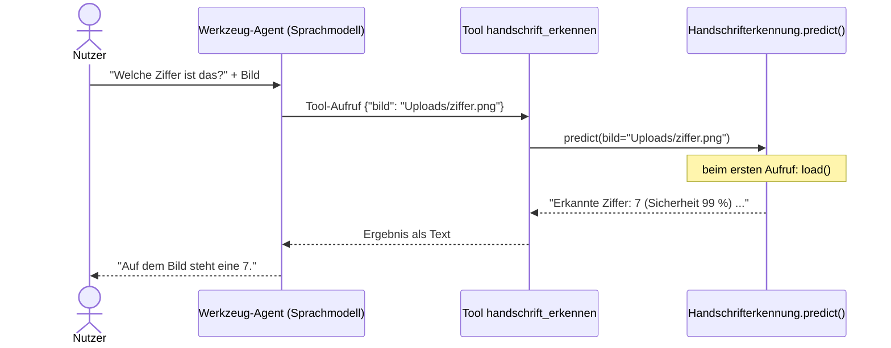

# Eigene neuronale Netze anbinden

Diese Anleitung zeigt, wie man ein selbst geschriebenes neuronales Netz (z. B. ein CNN zur Handschrifterkennung oder ein LSTM zur Kursprognose) an den Chatbot anbindet. Danach kann der Werkzeug-Agent das Netz im Chat aufrufen, genauso wie er Dokumente durchsucht oder Bilder erzeugt.

Der Code des Chatbots muss dafür **nicht** geändert werden. Man legt einen Ordner unter `networks/` an, schreibt darin eine kleine Klasse und startet den Chatbot neu.

**Inhalt**

1. [Wie es funktioniert](#1-wie-es-funktioniert)
2. [Schnellstart mit den Beispielen](#2-schnellstart-mit-den-beispielen)
3. [Eigenes Netz anbinden: Schritt für Schritt](#3-eigenes-netz-anbinden-schritt-für-schritt)
4. [Referenz: die Klasse `NeuralNetwork`](#4-referenz-die-klasse-neuralnetwork)
5. [Eingaben: Wie Dateien und Werte zum Netz kommen](#5-eingaben-wie-dateien-und-werte-zum-netz-kommen)
6. [Ausgaben: Text und Bilder](#6-ausgaben-text-und-bilder)
7. [Beschreibungen, die das Sprachmodell versteht](#7-beschreibungen-die-das-sprachmodell-versteht)
8. [Beispiel 1: Handschrifterkennung (CNN)](#8-beispiel-1-handschrifterkennung-cnn)
9. [Beispiel 2: Aktienkursprognose (LSTM)](#9-beispiel-2-aktienkursprognose-lstm)
10. [Andere Frameworks: Keras, scikit-learn, ONNX](#10-andere-frameworks-keras-scikit-learn-onnx)
11. [Netze in einem eigenen Agenten mit `create_agent`](#11-netze-in-einem-eigenen-agenten-mit-create_agent)
12. [Fehlerbehebung](#12-fehlerbehebung)
13. [Checkliste](#13-checkliste)

---

## 1. Wie es funktioniert

### Das Netz wird ein Tool, das Sprachmodell bleibt der Agent

In LangChain baut man einen Agenten mit `create_agent`:

```python
agent = create_agent(model=sprachmodell, tools=[tool_1, tool_2, ...])
```

- **`model`** ist ein Sprachmodell (LLM). Es liest die Nachricht, entscheidet, welches Tool es mit welchen Argumenten aufruft, liest das Ergebnis und schreibt die Antwort.
- **`tools`** sind Funktionen, die das Sprachmodell aufrufen kann. Jedes Tool hat einen Namen, eine Beschreibung und Parameter.

Ein eigenes Netz gehört in die Liste **`tools`**, nicht an die Stelle von `model`. Ein CNN zur Handschrifterkennung liefert zehn Wahrscheinlichkeiten. Es kann weder eine Frage lesen noch entscheiden, was als Nächstes zu tun ist, und auch keine Antwort formulieren. Das übernimmt weiterhin das Sprachmodell. Das Netz ist der Spezialist, den das Sprachmodell bei Bedarf fragt.

Im Chatbot geschieht das in `src/Agents/chat_agent.py`:

```python
tools = TOOLS + neural_networks.tools()   # eingebaute Tools + alle eigenen Netze
create_agent(model=model, tools=tools, ...)
```

### Ablauf einer Anfrage



1. Beim ersten Aufbau des Agenten sucht der Chatbot in `networks/` nach Ordnern mit einer Datei `network.py`.
2. In jeder `network.py` sucht er Klassen, die von `NeuralNetwork` erben, und legt je Klasse ein Objekt an.
3. Aus jedem Netz wird ein LangChain-Tool: Name und Beschreibung kommen aus den Klassenattributen, die Parameter aus der Signatur von `predict()`.
4. Das Sprachmodell sieht diese Tools und ruft eines auf, wenn die Frage dazu passt.
5. Der Chatbot ruft `load()` auf (nur beim ersten Mal) und dann `predict(...)` mit den Argumenten des Sprachmodells.
6. Der Rückgabetext geht an das Sprachmodell zurück. Das Chat-Modell formuliert daraus die Antwort.

### Was das Sprachmodell zu sehen bekommt

Das Sprachmodell sieht **nicht** den Code des Netzes, sondern nur diese Beschreibung (gekürzt):

```json
{
  "name": "handschrift_erkennen",
  "description": "Erkennt eine einzelne handgeschriebene Ziffer (0 bis 9) auf einem Bild im Workspace, ...",
  "parameters": {
    "bild": {"type": "string", "description": "Pfad des Bildes im Workspace, z. B. \"Uploads/ziffer.png\"."}
  }
}
```

Name, Beschreibung und Parameterbeschreibungen entscheiden also, ob das Sprachmodell das Netz richtig einsetzt. Mehr dazu in [Abschnitt 7](#7-beschreibungen-die-das-sprachmodell-versteht).

### Beteiligte Dateien

| Datei | Aufgabe |
|---|---|
| `networks/<ordner>/network.py` | **Deine Datei:** Klasse für das Netz (Pflicht) |
| `networks/<ordner>/...` | Deine weiteren Dateien: Architektur, Training, Gewichte |
| `src/Agents/neural_networks.py` | Basisklasse `NeuralNetwork`, Netze finden, Netz als Tool verpacken, Kommandozeile |
| `src/Agents/chat_agent.py` | gibt die Netze an `create_agent` und nennt sie im System-Prompt |
| `src/ui/chainlit_app.py` | legt angehängte Dateien im Workspace ab und zeigt die Arbeitsschritte an |

---

## 2. Schnellstart mit den Beispielen

Im Repository liegen zwei fertige Beispiele: `networks/handschrift/` (CNN) und `networks/aktienkurs/` (LSTM). Sie brauchen PyTorch und Pillow, die der Installer mitbringt (nicht mit `--no-image` installieren).

**1. Umgebung aktivieren**

```bash
source .venv/bin/activate        # Windows: .venv\Scripts\activate
```

**2. Netze trainieren.** Die Gewichte sind nicht im Repository, sie entstehen beim Training.

```bash
python networks/handschrift/train.py            # lädt MNIST (12 MB), ca. 20 s auf GPU, einige Minuten auf CPU
python networks/aktienkurs/train.py --demo      # künstliche Kurse, nur zum Ausprobieren, wenige Sekunden
```

Ausgabe (Handschrift):

```
Training auf cuda, 60000 Bilder, 3 Epochen
Epoche 1: Verlust 0.0557, Genauigkeit Testdaten 97.65%
Epoche 2: Verlust 0.0553, Genauigkeit Testdaten 98.88%
Epoche 3: Verlust 0.0274, Genauigkeit Testdaten 98.90%
Gespeichert: .../networks/handschrift/ziffern_cnn.pt
```

**3. Prüfen, ob der Chatbot die Netze findet**

```bash
python main.py --mode networks
```

```
Netz-Ordner: /.../RAG_Chatbot/networks
  OK  aktienkurs_vorhersagen       aktienkurs/      bereit
  OK  handschrift_erkennen         handschrift/     bereit
```

**4. Ein Netz direkt aufrufen, ohne Sprachmodell.** So sieht man, was das Netz dem Sprachmodell zurückgibt.

```bash
python main.py --mode networks --network handschrift_erkennen --args '{"bild": "Uploads/ziffer.png"}'
```

(Unter Windows in der Eingabeaufforderung: `--args "{\"bild\": \"Uploads/ziffer.png\"}"`.)

Das Bild muss dafür im Workspace liegen, hier `workspace/Uploads/ziffer.png`.

**5. Im Chat benutzen.** Chatbot starten (`python main.py`), ein Foto einer handgeschriebenen Ziffer an die Nachricht hängen (Büroklammer) und fragen: *„Welche Ziffer steht auf dem Bild?“*. In den Arbeitsschritten erscheint *Handschrift erkennen* mit Eingabe und Ergebnis.

Für die Kursprognose eine CSV-Datei mit historischen Kursen anhängen und fragen: *„Wie entwickelt sich der Kurs in den nächsten 5 Handelstagen?“*. Die Antwort enthält eine Tabelle und ein Diagramm.

---

## 3. Eigenes Netz anbinden: Schritt für Schritt

Als Beispiel dient ein Netz, das aus einem Bild erkennt, ob ein Bauteil defekt ist. Ersetze Namen und Inhalt durch dein eigenes Netz.

### Schritt 1: Ordner anlegen

```
networks/
└── bauteilpruefung/          beliebiger Ordnername (keine Punkte oder Unterstriche am Anfang)
    ├── network.py            Pflicht: Anbindung an den Chatbot
    ├── model.py              empfohlen: Architektur des Netzes (nur PyTorch)
    ├── train.py              empfohlen: Training, speichert die Gewichte
    └── bauteil_cnn.pt        Gewichte (entstehen mit train.py)
```

Nur `network.py` ist Pflicht. Die Aufteilung in `model.py` und `train.py` hat einen Grund: Training und Einsatz brauchen **dieselbe** Architektur. Steht sie in `model.py`, importieren beide Dateien sie von dort und können nicht auseinanderlaufen.

### Schritt 2: Architektur und Training

`model.py` enthält nur das Netz, ohne Imports aus dem Chatbot:

```python
import torch
from torch import nn


class BauteilCNN(nn.Module):
    def __init__(self) -> None:
        super().__init__()
        self.features = nn.Sequential(
            nn.Conv2d(3, 16, 3, padding=1), nn.ReLU(), nn.MaxPool2d(2),
            nn.Conv2d(16, 32, 3, padding=1), nn.ReLU(), nn.AdaptiveAvgPool2d(1),
        )
        self.classifier = nn.Linear(32, 2)   # 0 = in Ordnung, 1 = defekt

    def forward(self, x: torch.Tensor) -> torch.Tensor:
        return self.classifier(self.features(x).flatten(1))
```

`train.py` trainiert das Netz wie gewohnt und speichert am Ende **nur die Gewichte** (`state_dict`):

```python
from pathlib import Path

import torch

from model import BauteilCNN          # liegt im selben Ordner

ORDNER = Path(__file__).resolve().parent

model = BauteilCNN()
# ... Daten laden, trainieren, auswerten ...
torch.save(model.state_dict(), ORDNER / "bauteil_cnn.pt")
```

Aufruf aus dem Projektordner: `python networks/bauteilpruefung/train.py`. In `train.py` steht `from model import ...` ohne Punkt: Python startet das Skript aus seinem eigenen Ordner und findet `model.py` dort.

> **Warum nur das `state_dict`?** `torch.save(model)` speichert das ganze Objekt mit Verweisen auf Modulnamen. Lädt man es in einem anderen Zusammenhang (z. B. im Chatbot), findet Python die Klasse oft nicht mehr. Das `state_dict` enthält nur Tensoren und lässt sich mit `torch.load(..., weights_only=True)` sicher laden.

### Schritt 3: `network.py` schreiben

Vorlage zum Kopieren, mit Erklärungen in den Kommentaren:

```python
"""Bauteilprüfung: erkennt auf einem Foto, ob ein Bauteil defekt ist."""
import numpy as np
import torch
from PIL import Image

from Agents.neural_networks import NeuralNetwork   # Basisklasse aus dem Chatbot

from .model import BauteilCNN                        # Punkt: Datei aus diesem Ordner


class Bauteilpruefung(NeuralNetwork):
    # Name des Tools: so ruft das Sprachmodell das Netz auf. Nur a-z, 0-9 und _.
    name = "bauteil_pruefen"
    # Anzeige in den Arbeitsschritten der Oberfläche
    label = "Bauteil prüfen"
    # Das liest das Sprachmodell: was das Netz kann, was es braucht, was es liefert
    description = (
        "Prüft auf einem Foto im Workspace, ob ein Bauteil defekt ist (z. B. Riss, Bruch). "
        "Liefert 'in Ordnung' oder 'defekt' und wie sicher sich das Netz ist."
    )
    # Ohne diese Dateien im Ordner wird das Netz nicht angeboten (z. B. noch nicht trainiert)
    required_files = ["bauteil_cnn.pt"]

    def load(self) -> None:
        """Einmal vor dem ersten Aufruf: Netz bauen und Gewichte laden."""
        self.model = BauteilCNN()
        gewichte = torch.load(self.file("bauteil_cnn.pt"), map_location="cpu", weights_only=True)
        self.model.load_state_dict(gewichte)
        self.model.eval()              # Dropout und BatchNorm in den Auswertungsmodus

    def predict(self, foto: str) -> str:
        """Prüft das Bauteil auf dem Foto.

        Args:
            foto: Pfad des Fotos im Workspace, z. B. "Uploads/bauteil.jpg".
        """
        pfad = self.workspace_file(foto)            # nur Dateien im Workspace, sonst Fehler
        bild = Image.open(pfad).convert("RGB").resize((128, 128))
        pixel = np.asarray(bild, dtype=np.float32) / 255            # (Höhe, Breite, 3), Werte 0 bis 1
        x = torch.from_numpy(pixel).permute(2, 0, 1).unsqueeze(0)   # (1, 3, Höhe, Breite) wie beim Training
        with torch.no_grad():
            p = torch.softmax(self.model(x), dim=1)[0]
        ergebnis = "defekt" if p[1] > 0.5 else "in Ordnung"
        return f"Bauteil: {ergebnis} (Sicherheit {max(p).item():.0%})."
```

Wichtig:

- `from .model import BauteilCNN` **mit Punkt**: Der Chatbot lädt jeden Netz-Ordner als eigenes Paket. Dadurch dürfen zwei Netze je eine `model.py` haben, ohne sich zu stören.
- `predict()` bekommt **Typangaben** (`foto: str`) und einen **Docstring mit `Args:`**. Daraus entsteht die Parameterbeschreibung für das Sprachmodell.
- Die Vorverarbeitung (Größe, Normalisierung, Farbkanäle) muss **genau** wie beim Training sein.
- Rückgabe ist ein kurzer, vollständiger Text. Das Sprachmodell sieht nur diesen Text.

### Schritt 4: Prüfen

```bash
python main.py --mode networks
```

Steht dort `OK ... bereit`, ist alles in Ordnung. Sonst steht in der Zeile der Grund, z. B. `Datei fehlt im Netz-Ordner: bauteil_cnn.pt (erst trainieren?)`. Mögliche Meldungen erklärt [Abschnitt 12](#12-fehlerbehebung).

### Schritt 5: Direkt aufrufen

```bash
python main.py --mode networks --network bauteil_pruefen --args '{"foto": "Uploads/bauteil.jpg"}'
```

Die Ausgabe zeigt das Tool so, wie das Sprachmodell es sieht (Name, Beschreibung, Argumente), und danach das Ergebnis. Fehler im Netz erscheinen hier mit Meldung, ohne dass ein Sprachmodell beteiligt ist. Erst wenn dieser Aufruf funktioniert, lohnt sich der Test im Chat.

### Schritt 6: Im Chat testen

Den Chatbot **neu starten**. Netze werden nur beim Start eingelesen. Dann ein Foto anhängen und z. B. fragen: *„Ist das Bauteil auf dem Foto in Ordnung?“*

Ruft das Sprachmodell das Netz nicht auf, hilft meist eine klarere Beschreibung ([Abschnitt 7](#7-beschreibungen-die-das-sprachmodell-versteht)) oder ein größeres Agent-Modell in den Einstellungen.

---

## 4. Referenz: die Klasse `NeuralNetwork`

Definiert in `src/Agents/neural_networks.py`. Import in eigener `network.py`:

```python
from Agents.neural_networks import NeuralNetwork, NetworkResult
```

### Klassenattribute

| Attribut | Pflicht | Bedeutung |
|---|---|---|
| `name` | ja | Tool-Name. Kleinbuchstaben `a`–`z`, Ziffern und `_`, beginnt mit Buchstabe, höchstens 64 Zeichen. Darf nicht wie ein eingebautes Tool heißen (`search_documents`, `list_files`, `read_file`, `write_file`, `make_directory`, `search_files`, `generate_image`, `generate_video`) und muss über alle Netze eindeutig sein. |
| `description` | ja | Was das Netz tut, was es braucht und was es liefert. Liest das Sprachmodell. Fehlt sie, wird der Docstring von `predict()` genommen. |
| `label` | nein | Anzeige in den Arbeitsschritten der Oberfläche, z. B. „Handschrift erkennen“. Standard: `name`. |
| `required_files` | nein | Liste von Dateinamen im Netz-Ordner. Fehlt eine, wird das Netz nicht angeboten. Typisch: die Gewichte. |
| `enabled` | nein | `False` schaltet das Netz ab, ohne den Ordner zu löschen. |
| `folder` | – | Ordner des Netzes, setzt der Chatbot. Nur lesen. |

### Methoden zum Überschreiben

| Methode | Pflicht | Bedeutung |
|---|---|---|
| `load(self)` | nein | Wird **einmal** vor dem ersten `predict()` aufgerufen. Hier Gewichte laden und das Netz bauen. Das Netz bleibt danach bis zum Neustart im Speicher. Ohne `load()` wird nichts vorab geladen. |
| `predict(self, ...)` | ja | Führt das Netz aus. Die Parameter werden zu Tool-Argumenten. Rückgabe: `str` oder `NetworkResult`. |

### Hilfsmethoden

| Methode | Bedeutung |
|---|---|
| `self.file("name")` | Pfad einer Datei im Netz-Ordner, z. B. `self.file("model.pt")`. |
| `self.workspace_file("Uploads/x.png")` | Pfad einer Datei im Workspace. Wirft `PermissionError` für Pfade außerhalb des Workspace (auch über `../` oder Symlinks) und `FileNotFoundError`, wenn die Datei fehlt. Für **alle** Dateipfade verwenden, die vom Sprachmodell kommen. |
| `self.new_image_path(".png")` | Neuer, eindeutiger Pfad im Bilderordner (`workspace/AIbilder/`) für ein Ergebnisbild. |
| `self.device()` | `"cuda"`, wenn PyTorch eine NVIDIA-GPU findet, sonst `"cpu"`. |

### Rückgabewerte von `predict()`

- **`str`**: Text für das Sprachmodell. Der Normalfall.
- **`NetworkResult(text, image)`**: Text für das Sprachmodell und zusätzlich ein Bild, das im Chat angezeigt wird (z. B. ein Diagramm). Siehe [Abschnitt 6](#6-ausgaben-text-und-bilder).
- Alles andere wird mit `str(...)` in Text umgewandelt.

### Parameter von `predict()` werden Tool-Argumente

Der Chatbot erzeugt das Argument-Schema mit LangChain aus der Signatur (`create_schema_from_function`, mit `parse_docstring=True`). Das Sprachmodell erhält es als JSON-Schema.

| Python | JSON-Schema für das Sprachmodell | Beispiel |
|---|---|---|
| `wert: str` | `"type": "string"` | `bild: str` |
| `wert: int` | `"type": "integer"` | `tage: int = 5` |
| `wert: float` | `"type": "number"` | `temperatur: float` |
| `wert: bool` | `"type": "boolean"` | `details: bool = False` |
| `wert: list[float]` | `"type": "array"` mit `number` | `messwerte: list[float]` |
| `wert: Literal["a", "b"]` | `"enum": ["a", "b"]` | `modus: Literal["schnell", "genau"] = "schnell"` |
| `wert: Optional[str] = None` | optional, darf fehlen | `vergleich: Optional[str] = None` |

- Parameter **ohne Standardwert** sind Pflicht, Parameter **mit Standardwert** darf das Sprachmodell weglassen.
- Die Beschreibung eines Parameters kommt aus dem Abschnitt `Args:` des Docstrings (Google-Stil, wie in den Beispielen). Jede Zeile hat die Form `name: Beschreibung.`
- Die Argumente werden geprüft und umgewandelt, bevor `predict()` aufgerufen wird. Schickt das Sprachmodell `"5"` für `tage: int`, kommt `5` an. Passt ein Argument nicht, bekommt das Sprachmodell eine Fehlermeldung.
- Grenzen trotzdem selbst prüfen (z. B. `tage = max(1, min(tage, 30))`). Das Schema prüft nur den Typ.

### Fehler

Wirft `load()` oder `predict()` eine Ausnahme, stürzt nichts ab. Das Sprachmodell bekommt den Text

```
Das neuronale Netz 'bauteil_pruefen' ist fehlgeschlagen: FileNotFoundError: 'Uploads/x.jpg' gibt es im Workspace nicht.
```

und gibt das in der Regel an den Nutzer weiter. Deshalb lohnt es sich, eigene Fehler mit verständlichen deutschen Meldungen zu werfen, z. B. `raise ValueError("Auf dem Bild ist keine Schrift zu erkennen.")`. Der vollständige Traceback steht im Log des Servers.

Schlägt `load()` fehl, wird es beim nächsten Aufruf erneut versucht.

### Gleichzeitige Aufrufe

Pro Netz läuft immer nur ein Aufruf gleichzeitig. Fragen zwei Nutzer zur selben Zeit, wartet der zweite kurz. `predict()` muss deshalb nicht thread-sicher sein.

---

## 5. Eingaben: Wie Dateien und Werte zum Netz kommen

### Der Workspace

Der Agent darf nur auf den Ordner `workspace/` zugreifen. Alle Dateipfade, die das Sprachmodell an ein Netz übergibt, sind relativ zu diesem Ordner, z. B. `Uploads/ziffer.png`. Mit `self.workspace_file(pfad)` wird daraus ein sicherer, absoluter Pfad.

### Angehängte Dateien im Chat

Hängt man im Chat Dateien an eine Nachricht (Büroklammer), legt der Chatbot sie im Workspace ab:

| Dateityp | Ablage | Zusätzlich |
|---|---|---|
| Dokumente: PDF, DOCX, TXT, MD, CSV, JSON, … | `workspace/Dateien/` | werden in die Wissensbasis aufgenommen |
| alles andere, z. B. Bilder | `workspace/Uploads/` | gleichnamige Dateien werden nicht überschrieben (`foto_1.png`, `foto_2.png`, …) |

An die Nachricht hängt der Chatbot für den Agenten einen Hinweis an:

```
Welche Ziffer steht auf dem Bild?

[Angehängte Dateien im Workspace: `Uploads/ziffer.png`]
```

So kennt das Sprachmodell den Pfad und übergibt ihn an das Netz. Der Hinweis erscheint nicht im Chatverlauf.

### Weitere Dateitypen erlauben

Welche Dateien man anhängen darf, steht in `src/ui/.chainlit/config.toml` unter `[features.spontaneous_file_upload]`:

```toml
accept = ["application/pdf", ..., "text/*", "image/*"]
```

Für ein eigenes Netz für Audio z. B. `"audio/*"` ergänzen, für NumPy-Dateien `{ "application/octet-stream" = [".npy"] }`. Danach den Chatbot neu starten.

### Werte direkt aus der Nachricht

Nicht jedes Netz braucht eine Datei. Das Sprachmodell kann Zahlen und Texte aus der Nachricht direkt übergeben:

```python
def predict(self, messwerte: list[float], einheit: str = "°C") -> str:
    """Erkennt Ausreißer in einer Messreihe.

    Args:
        messwerte: Die Messwerte in zeitlicher Reihenfolge.
        einheit: Einheit der Messwerte.
    """
```

Auf *„Sind in 20,1; 20,3; 35,9; 20,2 Ausreißer?“* ruft das Sprachmodell `predict(messwerte=[20.1, 20.3, 35.9, 20.2])` auf.

---

## 6. Ausgaben: Text und Bilder

### Text

Der Rückgabetext ist alles, was das Sprachmodell vom Netz erfährt. Gute Rückgabetexte:

- enthalten das Ergebnis **und** wie sicher es ist (`Erkannte Ziffer: 7 (Sicherheit 99 %)`),
- nennen Einheiten und Bezüge (`Letzter Schlusskurs (27.10.2025): 99.33`),
- sind kurz. Das Chat-Modell bekommt höchstens 1500 Zeichen je Tool-Ergebnis,
- enthalten nötige Hinweise selbst (`keine Anlageberatung`). Das Sprachmodell gibt sie dann eher weiter.

Liefert das Agent-Modell nach dem Tool-Aufruf keinen Text (kommt bei sehr kleinen Modellen vor), zeigt der Chatbot das Tool-Ergebnis direkt an.

### Bilder

Soll im Chat ein Bild erscheinen, z. B. ein Diagramm, eine Heatmap oder ein markiertes Foto, gibt `predict()` ein `NetworkResult` zurück:

```python
from Agents.neural_networks import NetworkResult

def predict(self, csv_datei: str) -> NetworkResult:
    ...
    bild = self.new_image_path()          # workspace/AIbilder/<Zeitstempel>_<name>.png
    diagramm.save(bild)                    # z. B. mit Pillow oder matplotlib
    return NetworkResult("Prognose: ...", bild)
```

Das Bild erscheint unter der Antwort und bleibt auch in gespeicherten Chats erhalten. Liegt das Bild woanders, kopiert der Chatbot es in den Bilderordner.

---

## 7. Beschreibungen, die das Sprachmodell versteht

Das Sprachmodell entscheidet nur anhand von Name, Beschreibung und Parameterbeschreibungen, ob und wie es ein Netz aufruft. Zusätzlich führt der Chatbot alle Netze mit der ersten Zeile ihrer Beschreibung im System-Prompt des Werkzeug-Agenten auf, damit auch kleine Modelle sie finden.

**Name:** ein Verb und ein Gegenstand, z. B. `handschrift_erkennen`, `aktienkurs_vorhersagen`, `bauteil_pruefen`. Keine Abkürzungen wie `cnn_v2`.

**Beschreibung:** Drei Fragen beantworten:

1. **Was** tut das Netz? („Erkennt eine einzelne handgeschriebene Ziffer (0 bis 9)“)
2. **Was braucht** es? („… auf einem Bild im Workspace, z. B. einem angehängten Foto“)
3. **Was liefert** es? („Liefert die erkannte Ziffer und wie sicher sich das Netz ist.“)

Grenzen gehören dazu: *„nur einzelne Ziffern, keine Buchstaben“* hält das Sprachmodell davon ab, das Netz für ganze Wörter zu benutzen.

**Parameter:** Format und ein Beispiel nennen: `bild: Pfad des Bildes im Workspace, z. B. "Uploads/ziffer.png".` Sprechende Namen (`csv_datei`, `tage`) helfen mehr als `x` und `n`.

**Kleine Modelle:** In einem Test hat `qwen3.5:2b` beide Beispielnetze mit den richtigen Argumenten aufgerufen. Bleiben Aufrufe aus, ein größeres Agent-Modell wählen (Einstellungen → *Werkzeug-Agent*). Viele Tools auf einmal überfordern kleine Modelle. Nicht benötigte Netze mit `enabled = False` abschalten.

---

## 8. Beispiel 1: Handschrifterkennung (CNN)

Ordner `networks/handschrift/`:

| Datei | Inhalt |
|---|---|
| `model.py` | `ZiffernCNN`: zwei Faltungsschichten (32 und 64 Filter) mit Max-Pooling, dann zwei vollverbundene Schichten mit Dropout, 10 Ausgaben. Dazu `MEAN` und `STD` der MNIST-Pixel. |
| `train.py` | Lädt MNIST (60 000 Trainings-, 10 000 Testbilder) direkt als IDX-Dateien, trainiert mit Adam und Kreuzentropie, speichert `ziffern_cnn.pt`. |
| `network.py` | Klasse `Handschrifterkennung` (Tool `handschrift_erkennen`) und `bild_vorbereiten()`. |

### Die Vorverarbeitung ist der wichtigste Teil

Das Netz hat nur MNIST gesehen: 28 × 28 Pixel, **helle** Ziffer auf **schwarzem** Grund, Ziffer etwa 20 × 20 Pixel groß, Schwerpunkt in der Bildmitte. Ein Handyfoto sieht völlig anders aus. `bild_vorbereiten()` gleicht das an:

1. Graustufen, Drehung aus den EXIF-Daten übernehmen
2. Farben umkehren, wenn der Hintergrund hell ist (dunkle Schrift auf Papier)
3. Kontrast strecken und schwache Pixel (Papierstruktur, Schatten) auf 0 setzen
4. auf die Schrift zuschneiden, die längere Seite auf 20 Pixel verkleinern
5. in ein 28 × 28-Feld setzen und den Schwerpunkt in die Mitte schieben
6. mit `MEAN` und `STD` normalisieren wie beim Training

Ohne diese Schritte rät das Netz bei echten Fotos fast nur. Das gilt für jedes eigene Netz: **Im Einsatz muss die Eingabe so aussehen wie beim Training.**

### Ergebnis

```
Erkannte Ziffer: 7 (Sicherheit 100%). Weitere Kandidaten: 2 (0%), 1 (0%).
```

Die weiteren Kandidaten helfen dem Sprachmodell, unsichere Fälle zu erkennen und nachzufragen.

### Erweitern

- **Mehrere Ziffern** (z. B. eine Postleitzahl): das Bild an leeren Spalten in einzelne Ziffern teilen und jede mit `bild_vorbereiten()` erkennen.
- **Buchstaben:** mit EMNIST trainieren und die Ausgabeschicht auf die Zahl der Klassen anpassen.
- **Robustere Erkennung:** beim Training zufällig drehen, verschieben und verzerren (Data Augmentation).

---

## 9. Beispiel 2: Aktienkursprognose (LSTM)

Ordner `networks/aktienkurs/`:

| Datei | Inhalt |
|---|---|
| `daten.py` | `schlusskurse_lesen()`: liest CSV-Dateien mit Kursen. Erkennt Komma oder Semikolon, Dezimalpunkt oder -komma, die Spalte mit dem Schlusskurs (`Close`, `Schlusskurs`, `Zuletzt`, …) und dreht die Reihenfolge, wenn die neuesten Kurse oben stehen. |
| `model.py` | `KursLSTM`: zwei LSTM-Schichten mit 64 Einheiten und eine lineare Ausgabe. `renditen()` und `FENSTER = 30`. |
| `train.py` | Bildet Fenster aus je 30 Tagesrenditen mit der Rendite des Folgetags als Ziel, trainiert mit MSE, vergleicht mit einer naiven Prognose, speichert `kurs_lstm.pt`. |
| `network.py` | Klasse `Aktienkursprognose` (Tool `aktienkurs_vorhersagen`) und `diagramm_zeichnen()`. |

### Renditen statt Kurse

Das Netz arbeitet mit täglichen logarithmischen Renditen in Prozent (`ln(Kurs heute / Kurs gestern) · 100`), nicht mit Kursen in Euro. Renditen liegen für fast alle Aktien in derselben Größenordnung. Deshalb funktioniert ein Netz, das mit einer Aktie für 50 € trainiert wurde, auch für eine Aktie für 500 €.

### Mehrere Tage vorhersagen

Das Netz schätzt immer nur den nächsten Tag. Für mehrere Tage hängt `predict()` jede Schätzung an die Folge an und schätzt erneut (Schritt für Schritt, „autoregressiv“). Fehler summieren sich dabei, ferne Tage sind also unsicherer.

### Mit echten Kursen trainieren

```bash
python networks/aktienkurs/train.py daten/dax.csv daten/sap.csv --epochen 30
```

Geeignet sind Exporte historischer Tageskurse, z. B. von Yahoo Finance (Spalten `Date`, `Close`) oder von Börsenseiten (`Datum;Schlusskurs`). Mehrere Jahre und mehrere Werte ergeben mehr Trainingsdaten.

`train.py` vergleicht das Netz mit der Annahme „morgen ändert sich nichts“ (Rendite 0):

```
Epoche 20: Fehler Prüfdaten 1.486 (ohne Netz, Rendite 0: 1.647)
```

Liegt der Fehler des Netzes nicht deutlich darunter, hat es nichts Brauchbares gelernt. Bei echten Kursen ist das eher die Regel als die Ausnahme, weil Kurse kaum vorhersagbar sind. Die mit `--demo` erzeugten Kurse sind künstlich und absichtlich vorhersagbar, damit man den Ablauf ausprobieren kann. **Das Demo-Netz taugt nicht für echte Prognosen.** Das Tool weist im Ergebnis darauf hin, dass es sich um keine Anlageberatung handelt.

### Diagramm

`predict()` zeichnet mit Pillow ein Liniendiagramm (letzte 90 Kurse blau, Prognose orange) und gibt es als `NetworkResult` zurück. Wer lieber matplotlib benutzt: `pip install matplotlib`, Diagramm mit `plt.savefig(self.new_image_path())` speichern.

---

## 10. Andere Frameworks: Keras, scikit-learn, ONNX

Die Basisklasse hängt nicht von PyTorch ab. `load()` und `predict()` dürfen beliebigen Python-Code enthalten. Fehlende Pakete in der `.venv` installieren (`pip install ...`) und, damit sie bei einer Neuinstallation nicht fehlen, in `pyproject.toml` unter `dependencies` eintragen.

**Keras / TensorFlow** (`pip install tensorflow`):

```python
import numpy as np

class KerasNetz(NeuralNetwork):
    name = "qualitaet_schaetzen"
    description = "..."
    required_files = ["modell.keras"]

    def load(self) -> None:
        import keras                      # erst hier importieren: der Chatbot startet schneller
        self.model = keras.saving.load_model(self.file("modell.keras"))

    def predict(self, messwerte: list[float]) -> str:
        """Args:
            messwerte: Die 12 Messwerte des Prüfstands.
        """
        y = self.model.predict(np.array([messwerte]), verbose=0)[0]
        return f"Geschätzte Qualität: {y[0]:.1f} von 10"
```

**scikit-learn** (`pip install scikit-learn joblib`):

```python
    def load(self) -> None:
        import joblib
        self.model = joblib.load(self.file("modell.joblib"))

    def predict(self, laenge: float, breite: float) -> str:
        klasse = self.model.predict([[laenge, breite]])[0]
        return f"Klasse: {klasse}"
```

**ONNX Runtime** (`pip install onnxruntime`), z. B. für ein aus einem anderen Framework exportiertes Netz:

```python
    def load(self) -> None:
        import onnxruntime
        self.session = onnxruntime.InferenceSession(str(self.file("netz.onnx")))

    def predict(self, werte: list[float]) -> str:
        import numpy as np
        eingabe = {self.session.get_inputs()[0].name: np.array([werte], dtype=np.float32)}
        ausgabe = self.session.run(None, eingabe)[0][0]
        return f"Ergebnis: {ausgabe.tolist()}"
```

Ein Import erst in `load()` hat einen Vorteil: Fehlt das Paket, meldet das Netz den Fehler beim Aufruf, und der Chatbot startet trotzdem schnell. Ein Import oben in `network.py` lässt dagegen schon das Einlesen scheitern, und `python main.py --mode networks` zeigt den Fehler sofort an. Beides geht, wichtig ist nur, dass man weiß, wo der Fehler erscheint.

---

## 11. Netze in einem eigenen Agenten mit `create_agent`

Die Netze lassen sich auch außerhalb des Chatbots in einem eigenen LangChain-Agenten benutzen, z. B. in einem Skript oder einem anderen Projekt. `neural_networks.tools()` liefert fertige LangChain-Tools:

```python
"""eigener_agent.py, im Projektordner ausführen: python eigener_agent.py"""
import sys

sys.path.insert(0, "src")

from langchain.agents import create_agent
from langchain_ollama import ChatOllama

from Agents import neural_networks

agent = create_agent(
    model=ChatOllama(model="qwen3.5:9b"),           # Sprachmodell mit Tool-Calling
    tools=neural_networks.tools(),                   # alle einsatzbereiten Netze aus networks/
    system_prompt="Du bist ein Prüfassistent. Nutze die Tools und erfinde keine Ergebnisse.",
)
antwort = agent.invoke({"messages": [{"role": "user", "content": "Welche Ziffer steht auf Uploads/ziffer.png?"}]})
print(antwort["messages"][-1].content)
```

Mit eigenen Tools gemischt:

```python
from langchain_core.tools import tool

@tool
def einheit_umrechnen(wert: float) -> str:
    """Rechnet Millimeter in Zoll um."""
    return f"{wert / 25.4:.3f} Zoll"

agent = create_agent(model=..., tools=[einheit_umrechnen, *neural_networks.tools()])
```

### Was `neural_networks.as_tool()` intern tut

Zum Verständnis: Ein Netz als Tool ist nichts anderes als ein `StructuredTool` von LangChain. Vereinfacht macht `as_tool()` Folgendes:

```python
from langchain_core.tools import StructuredTool
from langchain_core.tools.base import create_schema_from_function

schema = create_schema_from_function(netz.name, netz.predict, parse_docstring=True)  # Argumente aus predict()

def aufrufen(**argumente):
    return neural_networks.run(netz, argumente)       # load() beim ersten Mal, predict(), Fehler abfangen

tool = StructuredTool.from_function(
    func=aufrufen,
    name=netz.name,
    description=netz.description,
    args_schema=schema,
    response_format="content_and_artifact",          # (Text für das Sprachmodell, Bild für die Oberfläche)
)
```

Ohne die Basisklasse könnte man jedes Netz also auch von Hand mit `@tool` oder `StructuredTool.from_function` verpacken. Die Basisklasse nimmt einem nur das Laden, die Fehlerbehandlung, die Pfadprüfung und das automatische Einlesen ab.

---

## 12. Fehlerbehebung

Erste Anlaufstelle ist immer `python main.py --mode networks`. Die Meldungen bedeuten:

| Meldung | Ursache und Lösung |
|---|---|
| `Keine Netze gefunden` | Kein Unterordner von `networks/` enthält eine `network.py`. Ordnername prüfen, er darf nicht mit `.` oder `_` beginnen. Anderer Ort: `NETWORKS_DIR` setzen. |
| `network.py fehlerhaft: ModuleNotFoundError: No module named 'torch'` | Paket fehlt in der `.venv`. `pip install ...` bzw. Installer ohne `--no-image`. |
| `network.py fehlerhaft: ImportError: attempted relative import ...` bzw. `No module named 'model'` | In `network.py` mit Punkt importieren: `from .model import ...`. In `train.py` dagegen ohne Punkt. |
| `network.py fehlerhaft: SyntaxError ...` | Tippfehler in `network.py`, die Meldung nennt die Zeile. |
| `keine Klasse, die von NeuralNetwork erbt` | `class MeinNetz(NeuralNetwork):` fehlt, oder die Klasse ist aus einer anderen Datei importiert. Sie muss in `network.py` selbst stehen. |
| `name '...' ist ungültig` | Nur Kleinbuchstaben, Ziffern und `_`, Beginn mit Buchstabe. Keine Umlaute oder Bindestriche. |
| `name '...' ist schon vergeben` | Ein anderes Netz oder ein eingebautes Tool heißt schon so. |
| `predict() fehlt` | Methode `predict` nicht oder falsch geschrieben. |
| `description fehlt` | `description` setzen oder `predict()` einen Docstring geben. |
| `Datei fehlt im Netz-Ordner: ...` | Gewichte noch nicht erzeugt: `train.py` ausführen. Oder Dateiname in `required_files` stimmt nicht. |
| `ausgeschaltet (enabled = False)` | Gewollt abgeschaltet. |
| Beim Aufruf: `... gibt es im Workspace nicht` | Pfad stimmt nicht. Dateien liegen relativ zu `workspace/`, angehängte Bilder unter `Uploads/`. |
| Beim Aufruf: `Error(s) while loading state_dict ... Missing key(s)` | Architektur in `model.py` passt nicht zu den gespeicherten Gewichten. Nach Änderungen an `model.py` neu trainieren. |
| Beim Aufruf: `size mismatch` oder falsche Tensorform | Vorverarbeitung liefert eine andere Form als beim Training, z. B. fehlende Batch-Dimension (`x.unsqueeze(0)`) oder Kanäle an falscher Stelle. |
| Netz erscheint mit `OK`, wird im Chat aber nicht aufgerufen | Chatbot nach dem Anlegen neu gestartet? Beschreibung verbessern ([Abschnitt 7](#7-beschreibungen-die-das-sprachmodell-versteht)), größeres Agent-Modell wählen, in der Frage deutlich sagen, was gewünscht ist. |
| Bild lässt sich im Chat nicht anhängen | Dateityp in `src/ui/.chainlit/config.toml` unter `accept` freigeben ([Abschnitt 5](#5-eingaben-wie-dateien-und-werte-zum-netz-kommen)). |
| Netz rät bei echten Daten schlecht, obwohl die Testgenauigkeit hoch ist | Die Eingabe im Einsatz sieht anders aus als im Training. Vorverarbeitung angleichen ([Abschnitt 8](#die-vorverarbeitung-ist-der-wichtigste-teil)). |

Ausführliche Fehler mit Traceback stehen im Terminal, in dem der Chatbot läuft.

---

## 13. Checkliste

- [ ] Ordner `networks/<name>/` mit `network.py` angelegt
- [ ] Architektur in `model.py`, von `train.py` und `network.py` gemeinsam genutzt
- [ ] Gewichte als `state_dict` gespeichert und in `required_files` eingetragen
- [ ] Klasse erbt von `NeuralNetwork`, `name` und `description` gesetzt
- [ ] `load()` lädt die Gewichte und ruft `model.eval()` auf
- [ ] `predict()` hat Typangaben und einen Docstring mit `Args:`
- [ ] Dateipfade aus dem Chat gehen durch `self.workspace_file(...)`
- [ ] Vorverarbeitung entspricht genau dem Training
- [ ] Rückgabe: kurzer Text mit Ergebnis und Sicherheit (oder `NetworkResult` mit Bild)
- [ ] `python main.py --mode networks` zeigt `OK ... bereit`
- [ ] Direktaufruf mit `--network ... --args ...` liefert das erwartete Ergebnis
- [ ] Chatbot neu gestartet und im Chat getestet
